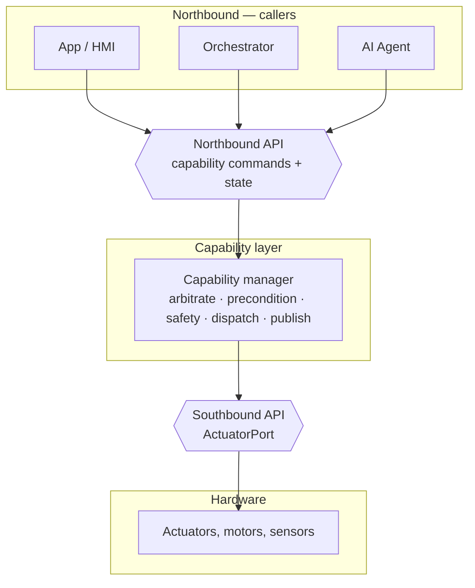

# COVESA Capability Framework — Reference Example

A distilled, external-facing reference for a **vehicle capability framework**,
with a **runnable** worked example. It shows how a capability is described once,
in a hardware-agnostic way, exposed to applications above it through a stable
**northbound** API, and bound to hardware below it through an abstract
**southbound** port.

This repository is the **base version** of the capability — the north star the
COVESA collaboration extends and evolves. The intent is that standardisation of
the capability, its northbound and southbound interfaces, and its model flows
back here with little rework.

It gives:

- the two API boundaries every capability sits between — **northbound** (apps
  and callers) and **southbound** (hardware),
- a **runnable power-window** capability driven by a **4-stage bond-graph motor
  model**,
- a **capability catalog** that is machine-checked against pinned COVESA
  **standards** rather than merely described, and
- a **rule checker** and a **knowledge graph** so a new capability cannot be added
  by assertion alone.

## Goals

This repository is being built out against four objectives. Each one is either
delivered in this checkout or has a defined path in [`plan.md`](plan.md).

| # | Goal | What "done" looks like | Status |
|---|---|---|---|
| 1 | **A complete example capability API catalog** | Several fully specified capabilities (descriptor, contract, implementation, binding, docs, requirements, tests) — not just windows | **Window complete**; three more planned (Phase 4) |
| 2 | **A capability rule checker** for every new capability | `capability-check --strict` runs in tests, pre-commit, and CI; every catalog entry passes | **Delivered** — 20+ rules, `CAP-0xx`–`CAP-6xx` |
| 3 | **First-class VSS and VDM integration** | Both standards pinned as submodules; generated artifacts reproducible; every mapping resolved against the pin; the window example uses them at runtime | **Delivered** for VSS + VDM |
| 4 | **A graph over VSS, VDM, and the capability framework** | A searchable, drill-down knowledge graph with a text-first view and a machine-readable export | **Delivered** (Phase 5); layered canvas view still open |

The point of goals 2–4 is not tooling for its own sake. A capability framework is
only useful if a machine can answer *what does this capability do, where is that
stated, and which standard decides the units* — without a human reading prose.
That is what the catalog, the checker, and the graph provide.

## Start here

**Run it** — one command starts a local app that calls the real northbound API
and drives the motor model behind the southbound port:

```bash
./bootstrap.sh                                        # .venv on Python 3.14: requirements + this package
.venv/bin/python -m capability_framework.app          # opens http://127.0.0.1:8770
```

Then move a window: every button issues a call to the capability's northbound
API, and each move is simulated by the bond-graph motor model. The page shows
the northbound response, the model's predicted KPIs, and the live `WINDOW_STATE`
event stream.

Five interactive views come with the app, cross-linked from the top bar of every
page:

- **Capability catalog** —
  [`/vehicle/catalog/`](http://127.0.0.1:8770/vehicle/catalog/)
  is the landing page: the capability tree, each capability's contract, its
  operations, and its model.
- **Stepable boundary view** —
  [`/vehicle/catalog/?cap=window&tab=boundary`](http://127.0.0.1:8770/vehicle/catalog/?cap=window&tab=boundary)
  draws the capability between its northbound and southbound boundaries, then
  replays a request through the five pipeline phases
  (Arbitrate → Precondition → Safety → Actuator → Publish). Play, step (or the
  `h`/`j`/`k`/`l` keys), and Reset light each stage in turn.
- **Physics playground** —
  [`/vehicle/api-explorer/`](http://127.0.0.1:8770/vehicle/api-explorer/)
  lets you pick a target position and run the real `WindowMotorModel`, plotting
  the transfer-function trajectory and its KPIs against the northbound call.
- **VSS signals** —
  [`/vehicle/signals/`](http://127.0.0.1:8770/vehicle/signals/)
  shows the live state as the standard's signals, quantized to the datatypes and
  ranges VSS declares (`Position` is a `uint8` percent, `IsOpen` a boolean).
  Move a window in the playground and watch them update.
- **Knowledge graph** —
  [`/vehicle/graph/`](http://127.0.0.1:8770/vehicle/graph/)
  joins the catalog, the OpenAPI contract, the pinned VSS signals, and the pinned
  VDM types into one navigable graph. Start at `window`, then follow `moveWindow`
  to the four `Switch` actuators it commands and the VDM field they project onto.

Two JSON surfaces expose the same data to anything that is not a browser:

- [`/vehicle/vss`](http://127.0.0.1:8770/vehicle/vss) — the capability's live state,
  expressed as VSS signals with the standard's datatypes and ranges.
- [`/vehicle/graph/model.json`](http://127.0.0.1:8770/vehicle/graph/model.json) — the
  full knowledge graph.

**Read it** — the repository, in the order worth looking at:

| # | Look at | Why |
|---|---|---|
| 1 | **[`docs/system-overview.html`](docs/system-overview.html)** | The whole picture: callers, the northbound/southbound boundaries, and the capability layer between them |
| 2 | **[`catalog/capabilities/window.yaml`](catalog/capabilities/window.yaml)** | The canonical capability entry: operations, VSS templates, VDM anchors, requirements |
| 3 | **[`docs/capability-rules.md`](docs/capability-rules.md)** | What the checker enforces, and why each rule exists |
| 4 | **[`docs/windows/move-window.md`](docs/windows/move-window.md)** | The worked capability definition and its requirements |
| 5 | **[`contracts/window-api.yaml`](contracts/window-api.yaml)** | The northbound contract (OpenAPI) |
| 6 | **[`src/capability_framework/semantics/`](src/capability_framework/semantics/)** | VSS index, VDM schema, catalog model, unit quantization, and the graph |
| 7 | **[`src/capability_framework/`](src/capability_framework/)** | The runtime: capability, southbound port, bond-graph model, HTTP adapter, app |

`docs/api-catalog.yaml` remains as a readable, exported view of the catalog; the
YAML under `catalog/capabilities/` is the source of truth that the checker
validates.

Power management and vehicle-state are **stubs** in this example — they are
platform services, not the capability, and are deliberately kept out of focus.

Run the tests:

```bash
PYTHONPATH=src .venv/bin/python -m pytest tests -q   # pytest comes from requirements.txt via ./bootstrap.sh
```

## Standards: VSS and VDM

Two COVESA standards are pinned as git submodules. They do different jobs, and
conflating them is the usual mistake.

| Standard | What it is | What it decides here |
|---|---|---|
| **VSS** — [Vehicle Signal Specification](third_party/vss) | A tree of signals with datatypes, units, ranges, and actuator/sensor kinds | The **vocabulary and the wire representation**: `Window.Position` is `uint8` percent, `0..100` |
| **VDM** — [Vehicle Data Model](third_party/vdm) | A cross-domain semantic model authored in GraphQL SDL (S2DM), carrying its own projection of VSS | The **concepts and relationships**: a `Window` type, `Door_InstanceTag` dimensions, `ChargingSession` |

Neither replaces the capability's own command and response semantics: a capability
is still `MoveWindowCommand → WindowState`. The standards say which signals that
behaviour reads and writes, and in what representation.

| Pinned | Ref | Licensed |
|---|---|---|
| [`COVESA/vehicle_signal_specification`](third_party/vss) | `v6.1` (`2817646d1808`) | MPL-2.0 |
| [`COVESA/vdm`](third_party/vdm) | commit `36bc93936eab` | unresolved — see the lock file |

`third_party/standards.lock.json` is the source of truth: refs, commits, licenses,
and the SHA-256 of every generated artifact. `./scripts/vendor_standards.sh`
re-exports `vss.json` from the pinned submodule and composes `vdm.graphql`, then
fails if the output differs from the lock file. The generated `vss.json` is
byte-identical to the official v6.1 release artifact, so "we generated it
ourselves" is checkable rather than trusted.

### The catalog is the join point

The capability catalog lives in [`catalog/capabilities/`](catalog/capabilities).
An entry names VSS **templates** instead of repeating a path per zone, and points at
VDM types and fields:

```yaml
vss:
  instances:
    DRIVER_FRONT: Vehicle.Cabin.Door.Row1.DriverSide.Window
    # ...
  signals:
    - id: window.position
      role: state
      template: "{instance}.Position"     # -> 4 concrete VSS paths
      datatype: uint8
      unit: percent
      vdm: {type: Window, field: position}
```

One template plus an instance map means adding a third row or a fourth door is a
data change, not a code change.

### VSS is used at runtime, not just in metadata

Before this work, VSS appeared only as descriptive strings. Now it is load-bearing:

```bash
curl -s localhost:8770/vehicle/vss | jq '.signals'
curl -s localhost:8770/vehicle/vss/Vehicle.Cabin.Door.Row1.DriverSide.Window.Position
```

```
{ "datatype": "uint8", "unit": "percent", "min": 0.0, "max": 100.0, "value": 100 }
```

`WindowState` is projected onto `Position`, `IsOpen`, and `Switch` per zone
(`capabilities/window/vss.py`). `Switch` is *derived* from the observed direction of
travel, because a state report does not carry a commanded direction. Paths come from
generated constants (`semantics/vss_paths.py`), so a typo cannot compile.

**Units are not accidental.** VSS models `Position` as a `uint8` percentage; the
northbound API keeps a float. `semantics.units` quantizes at the boundary using the
range from the standard, and raises on out-of-range input instead of clamping it
silently.

### VDM joins the two

VDM annotates its fields with the VSS path they project
(`@vspec(fqn: "Vehicle.Cabin.Door.Window.Position")`). That annotation is the join,
and it is **VDM's** assertion rather than ours: the knowledge graph's `PROJECTS_TO`
edges come from it, and `CAP-342` fails the build if a capability maps VSS and VDM
to different signals for the same behaviour.

One wrinkle is worth knowing: **VDM collapses instance dimensions**. It models
`Vehicle.Cabin.Door.Window.Position` and expresses `Row1`/`DriverSide` as
`Door_InstanceTag` enums. Any VSS↔VDM comparison therefore normalizes dimension
segments first — the abstract and concrete views are reconciled rather than fudged.
The checker also validates the zone map against those enums, so
`PASSENGER_REAR → {ROW2, PASSENGER_SIDE}` is proven, not assumed.

### What is checked, not claimed

```bash
./scripts/vendor_standards.sh                                   # pins + artifact hashes
.venv/bin/python -m capability_framework.checker --strict        # catalog + standards
```

- Pins and artifact hashes: `tests/test_standards_pins.py`
- Generated path constants are current: `scripts/gen_vss_paths.py --check`
- Every mapping resolves with the right datatype, unit, and actuator role: `CAP-2xx`
- Every VDM reference resolves and agrees with VSS: `CAP-3xx`
- Every requirement and operation names a test that exists: `CAP-5xx`, `CAP-6xx`

Two defects the checker caught on its first run were fixed rather than baselined:
an exposed HTTP route with no `operationId` in the contract, and the
instance-dimension mismatch described above.

### Where to see it

- [`/vehicle/vss`](http://127.0.0.1:8770/vehicle/vss) — live state as VSS signals.
  [`/vehicle/signals/`](http://127.0.0.1:8770/vehicle/signals/) is the human view of
  the same payload.
- [`/vehicle/graph/`](http://127.0.0.1:8770/vehicle/graph/) — catalog, contract, VSS,
  and VDM as one navigable graph. Text-first by design, with the JSON model as the
  real product: `curl -s localhost:8770/vehicle/graph/model.json | jq '.meta'`
- [`docs/capability-rules.md`](docs/capability-rules.md),
  [`docs/knowledge-graph.md`](docs/knowledge-graph.md),
  [`docs/standards-compatibility.md`](docs/standards-compatibility.md), and
  [`adr/`](adr/).

## Why a capability layer

A vehicle exposes functionality through many signals on many buses. Applications
should not need to know CAN identifiers, ECU addresses, or supplier pinouts to ask
a window to move.

A capability sits between the two:

| Layer | What it describes | Shaped by |
|---|---|---|
| **Signal** | A raw value on CAN, Ethernet, or a service bus | Hardware / ECU supplier |
| **API** | A callable endpoint wrapping one or more signals | Software, still hardware-shaped |
| **Capability** | What the vehicle *does*, in domain language | The problem domain |

The capability model does not change when the hardware underneath it does. Only
the southbound binding changes. That separation is the whole point.

## The two boundaries



- **Northbound**: exactly what callers may ask for. Semantic, versioned, and
  free of any hardware address.
- **Southbound**: the abstract actuator interface a capability depends on. One
  binding maps it to real hardware; another maps it to a simulator. Capability
  code never changes between them.

Nothing above the northbound boundary references an ECU, bus, or signal ID.
Nothing below the southbound boundary references an arbitration rule or a domain
concept.

## What is in this repository

| Path | What it is |
|---|---|
| [`src/capability_framework/`](src/capability_framework/) | The framework: event bus, southbound ports + deployment profile, capability base, the window capability, the bond-graph model, the northbound HTTP adapter, and the runnable app |
| [`src/capability_framework/semantics/`](src/capability_framework/semantics/) | Standards grounding: VSS index, VDM schema, catalog model, unit quantization, live VSS snapshot, and the knowledge graph |
| [`src/capability_framework/checker/`](src/capability_framework/checker/) | The rule checker and `capability-check` CLI, plus the exemption baseline |
| [`src/capability_framework/explorer/`](src/capability_framework/explorer/) | The interactive views: the stepable boundary diagram, the API catalog, the physics playground, and the knowledge graph page |
| [`catalog/capabilities/`](catalog/capabilities/) | The canonical capability catalog — operations, VSS templates, VDM anchors, requirements |
| [`third_party/`](third_party/) | Pinned VSS and VDM submodules, the standards lock file, and generated artifacts |
| [`scripts/`](scripts/) | Vendoring, VSS path generation, graph export, and the standards bump workflow |
| [`adr/`](adr/) | The decisions behind pinning, generating, and checking in standards artifacts |
| [`docs/system-overview.html`](docs/system-overview.html) | The top-level system view: nodes, the northbound and southbound boundaries, and how a capability sits between them |
| [`docs/capability-rules.md`](docs/capability-rules.md) | Every rule the checker enforces |
| [`docs/knowledge-graph.md`](docs/knowledge-graph.md) | The capability/VSS/VDM graph: schema, endpoints, limits |
| [`docs/standards-compatibility.md`](docs/standards-compatibility.md) | Which framework version was validated against which standard pins |
| [`docs/api-catalog.yaml`](docs/api-catalog.yaml) | Readable export of the catalog for humans and tooling |
| [`docs/windows/window-system.md`](docs/windows/window-system.md) | The generic power-window capability: system diagram, interfaces, and behaviour |
| [`docs/windows/window-system.svg`](docs/windows/window-system.svg) | Static rendered diagram of the window system and its bindings |
| [`docs/windows/move-window.md`](docs/windows/move-window.md) | The worked capability definition and its requirements |
| [`contracts/window-api.yaml`](contracts/window-api.yaml) | The northbound OpenAPI contract for the window capability |

## Metadata layering

Capability metadata has three layers, and only the first two live in this
repository:

| Layer | Scope | Example |
|---|---|---|
| **Signal reference** | Global, standard-owned | `Vehicle.Cabin.Door.Row1.DriverSide.Window.Position` |
| **Capability semantics** | Capability-scoped | `MoveWindowCommand` → `WindowState` |
| **Deployment binding** | Programme-scoped | transport, zone topology, supplier |

The third layer is where an integrator binds the capability to real hardware. It is
deliberately absent here — which is why nothing above the northbound boundary names
an ECU or a bus, and why the checker treats a leaked bus id as an error rather than
a style issue (`CAP-410`).

## License

See [`LICENSE`](LICENSE).