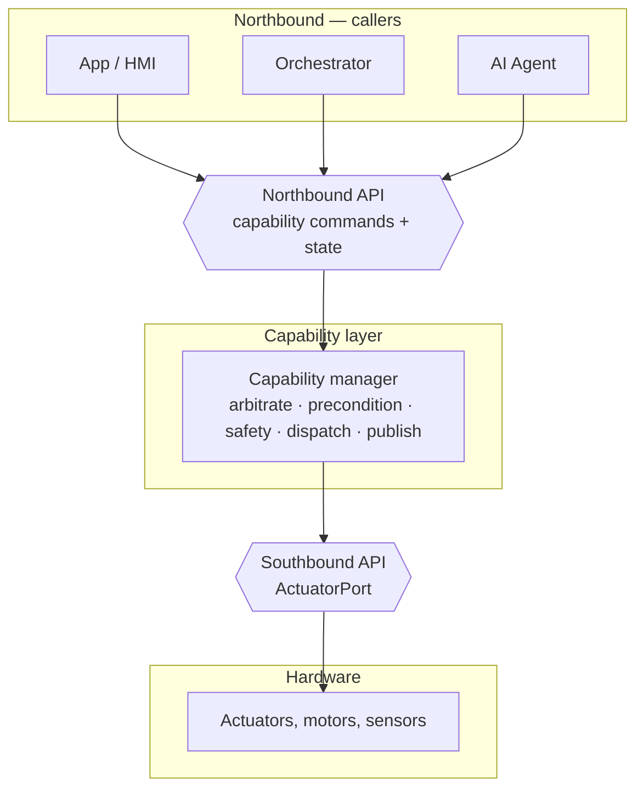

# COVESA Capability Framework — Reference Example

A distilled, external-facing reference for a **vehicle capability framework**.
It shows how a capability is described once, in a hardware-agnostic way, and then
exposed to applications above it while hiding the actuators below it.

This repository is an **example**, not a library. It contains documentation,
diagrams, and interface contracts only — no runnable code. The aim is to give a
shared picture of:

- the two API boundaries every capability sits between — **northbound** (apps
  and callers) and **southbound** (hardware), and
- the shape of an **API catalog** that lets capabilities be discovered and
  reasoned about generically.

The worked example throughout is a single, generic **power window** capability.

## Why a capability layer

A vehicle exposes functionality through many signals on many buses. Applications
should not need to know CAN identifiers, ECU addresses, or supplier pinouts to ask
a window to move.

A capability sits between the two:

| Layer | What it describes | Shaped by |
|---|---|---|
| **Signal** | A raw value on CAN, Ethernet, or a service bus | Hardware / ECU supplier |
| **API** | A callable endpoint wrapping one or more signals | Software, still hardware-shaped |
| **Capability** | What the vehicle *does*, in domain language | The problem domain |

The capability model does not change when the hardware underneath it does. Only
the southbound binding changes. That separation is the whole point.

## The two boundaries

- **Northbound**: exactly what callers may ask for. Semantic, versioned, and
  free of any hardware address.
- **Southbound**: the abstract actuator interface a capability depends on. One
  binding maps it to real hardware; another maps it to a simulator. Capability
  code never changes between them.

Nothing above the northbound boundary references an ECU, bus, or signal ID.
Nothing below the southbound boundary references an arbitration rule or a domain
concept.

## What is in this repository

| Path | What it is |
|---|---|
| [`docs/system-overview.html`](docs/system-overview.html) | The top-level system view: nodes, the northbound and southbound boundaries, and how a capability sits between them |
| [`docs/api-catalog.yaml`](docs/api-catalog.yaml) | The machine-readable capability catalog — northbound and southbound APIs, and the system model |
| [`docs/windows/window-system.md`](docs/windows/window-system.md) | The generic power-window capability: system diagram, interfaces, and behaviour |
| [`docs/windows/window-system.svg`](docs/windows/window-system.svg) | Static rendered diagram of the window system and its bindings |
| [`docs/windows/move-window.md`](docs/windows/move-window.md) | The worked capability definition and its requirements |
| [`contracts/window-api.yaml`](contracts/window-api.yaml) | The northbound OpenAPI contract for the window capability |

## Standards alignment

The example keeps its data model aligned with the **COVESA Vehicle Signal
Specification (VSS)**. Every window position carries a VSS path
(`Vehicle.Cabin.Door.Row1.DriverSide.Window.Position`), so a capability model is
a thin, semantic layer over VSS rather than a parallel vocabulary.

Capability metadata is layered:

| Layer | Scope | Example |
|---|---|---|
| **Signal reference** | Global | `Vehicle.Cabin.Door.Row1.DriverSide.Window.Position` |
| **Capability semantics** | Capability-scoped | `MoveWindowCommand` → `WindowState` |
| **Deployment binding** | Programme-scoped | transport, zone topology, supplier |

Only the first two appear in this repository; the third is where an integrator
binds the capability to real hardware.

## How to read this repository

1. Start with [`docs/system-overview.html`](docs/system-overview.html) for the
   overall picture.
2. Read [`docs/api-catalog.yaml`](docs/api-catalog.yaml) for how capabilities
   are catalogued and discovered.
3. Walk the worked example from
   [`docs/windows/move-window.md`](docs/windows/move-window.md) through to
   [`contracts/window-api.yaml`](contracts/window-api.yaml).

## License

See [`LICENSE`](LICENSE).