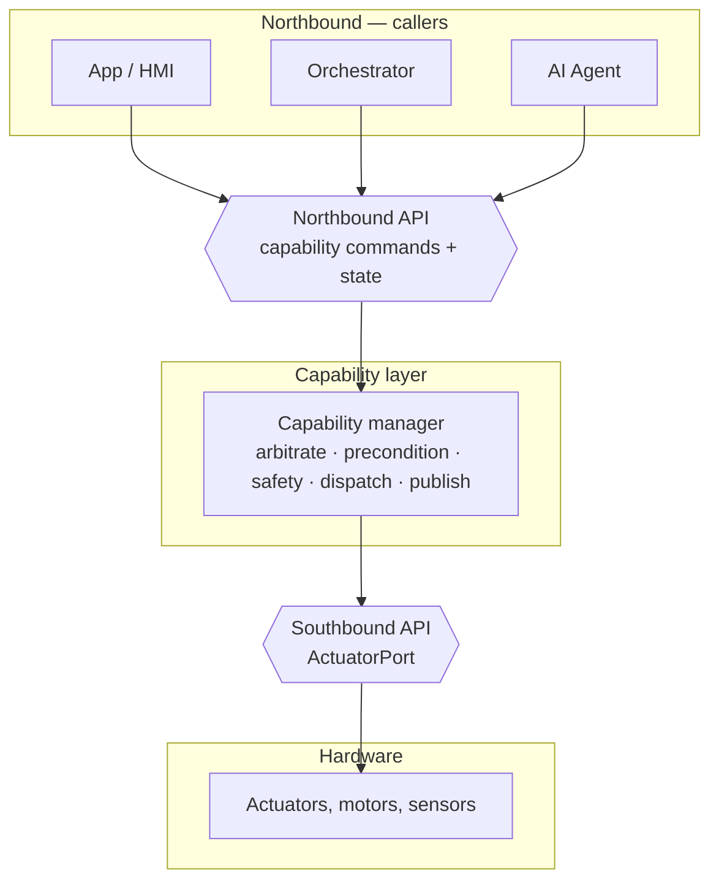

# COVESA Capability Framework — Reference Example

A distilled, external-facing reference for a **vehicle capability framework**,
with a **runnable** worked example. It shows how a capability is described once,
in a hardware-agnostic way, exposed to applications above it through a stable
**northbound** API, and bound to hardware below it through an abstract
**southbound** port.

This repository is the **base version** of the capability — the north star the
COVESA collaboration extends and evolves. The intent is that standardisation of
the capability, its northbound and southbound interfaces, and its model flows
back here with little rework.

It gives:

- the two API boundaries every capability sits between — **northbound** (apps
  and callers) and **southbound** (hardware),
- a **runnable power-window** capability driven by a **4-stage bond-graph motor
  model**, and
- the shape of an **API catalog** that lets capabilities be discovered and
  reasoned about generically.

## Start here

**Run it** — one command starts a local app that calls the real northbound API
and drives the motor model behind the southbound port:

```bash
./bootstrap.sh                                        # .venv on Python 3.14: requirements + this package
.venv/bin/python -m capability_framework.app          # opens http://127.0.0.1:8770
```

Then move a window: every button issues a call to the capability's northbound
API, and each move is simulated by the bond-graph motor model. The page shows
the northbound response, the model's predicted KPIs, and the live `WINDOW_STATE`
event stream.

Two interactive views come with the app:

- **Stepable boundary view** —
  [`/vehicle/catalog/?cap=window&tab=boundary`](http://127.0.0.1:8770/vehicle/catalog/?cap=window&tab=boundary)
  draws the capability between its northbound and southbound boundaries, then
  replays a request through the five pipeline phases
  (Arbitrate → Precondition → Safety → Actuator → Publish). Play, step (or the
  `h`/`j`/`k`/`l` keys), and Reset light each stage in turn.
- **Physics playground** —
  [`/vehicle/api-explorer/`](http://127.0.0.1:8770/vehicle/api-explorer/)
  lets you pick a target position and run the real `WindowMotorModel`, plotting
  the transfer-function trajectory and its KPIs against the northbound call.

**Read it** — the repository, in the order worth looking at:

| # | Look at | Why |
|---|---|---|
| 1 | **[`docs/system-overview.html`](docs/system-overview.html)** | The whole picture: callers, the northbound/southbound boundaries, and the capability layer between them |
| 2 | **[`docs/api-catalog.yaml`](docs/api-catalog.yaml)** | How capabilities are catalogued and discovered |
| 3 | **[`docs/windows/move-window.md`](docs/windows/move-window.md)** | The worked capability definition and its requirements |
| 4 | **[`contracts/window-api.yaml`](contracts/window-api.yaml)** | The northbound contract (OpenAPI) |
| 5 | **[`src/capability_framework/`](src/capability_framework/)** | The code: capability, southbound port, bond-graph model, HTTP adapter, app |

Power management and vehicle-state are **stubs** in this example — they are
platform services, not the capability, and are deliberately kept out of focus.

Run the tests:

```bash
PYTHONPATH=src .venv/bin/python -m pytest tests -q   # pytest comes from requirements.txt via ./bootstrap.sh
```

## Why a capability layer

A vehicle exposes functionality through many signals on many buses. Applications
should not need to know CAN identifiers, ECU addresses, or supplier pinouts to ask
a window to move.

A capability sits between the two:

| Layer | What it describes | Shaped by |
|---|---|---|
| **Signal** | A raw value on CAN, Ethernet, or a service bus | Hardware / ECU supplier |
| **API** | A callable endpoint wrapping one or more signals | Software, still hardware-shaped |
| **Capability** | What the vehicle *does*, in domain language | The problem domain |

The capability model does not change when the hardware underneath it does. Only
the southbound binding changes. That separation is the whole point.

## The two boundaries



- **Northbound**: exactly what callers may ask for. Semantic, versioned, and
  free of any hardware address.
- **Southbound**: the abstract actuator interface a capability depends on. One
  binding maps it to real hardware; another maps it to a simulator. Capability
  code never changes between them.

Nothing above the northbound boundary references an ECU, bus, or signal ID.
Nothing below the southbound boundary references an arbitration rule or a domain
concept.

## What is in this repository

| Path | What it is |
|---|---|
| [`src/capability_framework/`](src/capability_framework/) | The framework: event bus, southbound ports + deployment profile, capability base, the window capability, the bond-graph model, the northbound HTTP adapter, and the runnable app |
| [`src/capability_framework/explorer/`](src/capability_framework/explorer/) | The interactive views: the stepable boundary diagram, the API catalog, and the physics playground |
| [`docs/system-overview.html`](docs/system-overview.html) | The top-level system view: nodes, the northbound and southbound boundaries, and how a capability sits between them |
| [`docs/api-catalog.yaml`](docs/api-catalog.yaml) | The machine-readable capability catalog — northbound and southbound APIs, and the system model |
| [`docs/windows/window-system.md`](docs/windows/window-system.md) | The generic power-window capability: system diagram, interfaces, and behaviour |
| [`docs/windows/window-system.svg`](docs/windows/window-system.svg) | Static rendered diagram of the window system and its bindings |
| [`docs/windows/move-window.md`](docs/windows/move-window.md) | The worked capability definition and its requirements |
| [`contracts/window-api.yaml`](contracts/window-api.yaml) | The northbound OpenAPI contract for the window capability |

## Standards alignment

The example keeps its data model aligned with the **COVESA Vehicle Signal
Specification (VSS)**. Every window position carries a VSS path
(`Vehicle.Cabin.Door.Row1.DriverSide.Window.Position`), so a capability model is
a thin, semantic layer over VSS rather than a parallel vocabulary.

Capability metadata is layered:

| Layer | Scope | Example |
|---|---|---|
| **Signal reference** | Global | `Vehicle.Cabin.Door.Row1.DriverSide.Window.Position` |
| **Capability semantics** | Capability-scoped | `MoveWindowCommand` → `WindowState` |
| **Deployment binding** | Programme-scoped | transport, zone topology, supplier |

Only the first two appear in this repository; the third is where an integrator
binds the capability to real hardware.

## License

See [`LICENSE`](LICENSE).