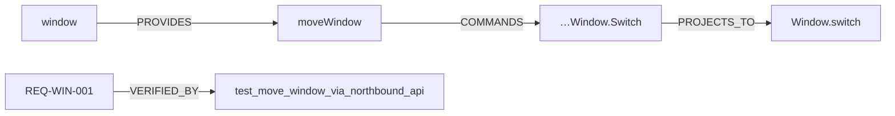

# Knowledge graph

The graph joins four artifacts that otherwise only agree by convention:

```text
capability catalog  →  OpenAPI contract  →  pinned VSS  →  pinned VDM
```

Every edge is derived from a checked file, so the picture cannot drift from the
code. Open it at **`/vehicle/graph/`** (`http://127.0.0.1:8770/vehicle/graph/`).

## Why a graph and not a page

A capability is not one thing. `moveWindow()` is an operation, offered by a
capability, described by two schemas in a contract, grounded in four VSS signal
families, projected onto a VDM type, and required to behave a certain way by four
requirements proven by tests. A flat table shows one of those columns; a graph
shows the joins.

The UI is deliberately **text-first**: a searchable, layer-grouped node list and a
neighbour table. It works by keyboard, reads well with a screen reader, and needs
no layout engine. The JSON model is the product; the page is a viewer.

## Schema

| Node | Id form | Layer |
|---|---|---|
| `Capability` | `cap:window` | capability |
| `Operation` | `op:window.moveWindow` | capability |
| `SouthboundPort` | `port:window.move_window` | capability |
| `Contract` | `contract:window-api` | contract |
| `Schema` | `schema:MoveWindowCommand` | contract |
| `VssSignal` | `vss:Vehicle.Cabin.Door.Row1.DriverSide.Window.Position` | vss |
| `VdmType` / `VdmField` | `vdm:Window` / `vdm:Window.position` | vdm |
| `Requirement` | `req:REQ-WIN-001` | safety |
| `TestCase` | `test:test_http_move_route` | safety |

| Relation | Meaning |
|---|---|
| `PROVIDES` | capability → operation |
| `REQUIRES` | capability → southbound port |
| `HAS_CONTRACT`, `HAS_SCHEMA` | capability → contract → schema |
| `COMMANDS` / `OBSERVES` | operation → VSS signal, by the signal's declared role |
| `PROJECTS_TO` | VSS signal → VDM field, from VDM's own `@vspec(fqn:)` |
| `ANCHORS` | capability → VDM type/field it declares |
| `HAS_REQUIREMENT`, `VERIFIED_BY` | capability → requirement → test |

`PROJECTS_TO` is the interesting edge: VDM annotates its fields with the VSS path
they project, so the graph joins the two standards using **their** assertion, not
ours. Where VDM collapses instance dimensions (`Vehicle.Cabin.Door.Window.Position`),
the join normalizes dimension segments first.

## Endpoints

| Route | Returns |
|---|---|
| `GET /vehicle/graph/` | the text-first viewer |
| `GET /vehicle/graph/model.json` | the whole graph (`meta`, `nodes`, `edges`) |
| `GET /vehicle/graph/node/<id>?depth=1..3` | bounded subgraph around a node |
| `GET /vehicle/graph/search?q=` | matching nodes |

Node ids contain `.` and `:`, so they are path segments, not query parameters.

## Determinism

Nodes are sorted by id and edges by `(source, relation, target)`; duplicate edges
are removed. Two builds from the same catalog and pins produce byte-identical
JSON — asserted in `tests/test_knowledge_graph.py`.

## Static export

```bash
make graph     # docs/graph/model.json + docs/graph/<capability>.mmd, then verifies
```

`docs/graph/window.mmd` is a Mermaid flowchart of the window capability two hops
out, small enough to review in a diff. `scripts/export_graph.py --check` fails if
the export is stale, so it is safe to run in CI.



## Known limits

- The graph covers **mapped** signals only. The full pinned VSS (1382 signals) is
  not loaded as nodes; the catalog decides what is in scope. `VssCatalog` can
  serve the rest for exploration, but a 1,382-node graph is not a useful default.
- Contract schemas are nodes, not fields: field-level schema edges are a later
  step.
- `depth` is capped at 3 per request; deep traversal of a large catalog should be a
  query, not a page load.
