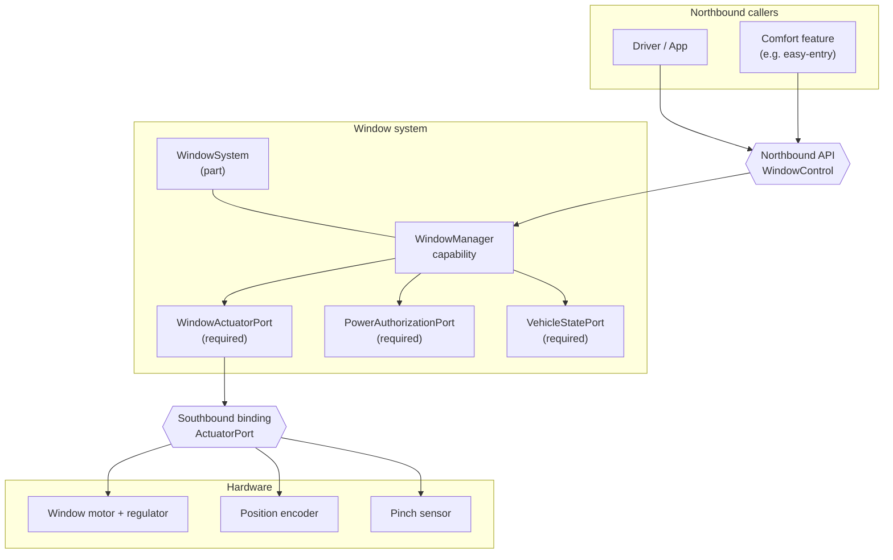
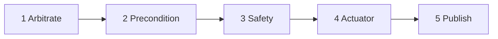

# Power Window Capability — System View

The worked example in this repository is a single, generic **power window**
capability. It is deliberately small and ordinary: the point is the *shape* of a
capability, not the window itself.

## System context

A window capability sits between callers that want the window to move and the
motor and sensors that actually move it.

A static rendition of this diagram is available as
[`window-system.svg`](window-system.svg).

## Interfaces

### Provided — northbound

| Operation | Kind | Meaning |
|---|---|---|
| `moveWindow` | async, arbitrated | Move a window to a target position |
| `releaseWindow` | sync, non-arbitrated | Release the lock this caller holds |
| `canExecuteWindow` | sync, no side effects | Pre-flight check |
| `getWindowState` | sync query | Read the current state for a zone |
| `getWindowSystemModel` | sync query | Introspect the physics model parameters |

### Required — southbound and infrastructure

| Interface | Provided by | Operations |
|---|---|---|
| `WindowActuation` | the hardware binding | `move_window(zone, target_pct)`, read position |
| `PowerAuthorization` | the power system | `request_power(budget_w)`, `release_power()` |
| `VehicleStateObservation` | the vehicle-state source | reads `power_state`, `ota_state`, `supply_voltage_v` |

## Zones

A window capability is per-zone. Zone identifiers are semantic, not positional:

| Zone | VSS path |
|---|---|
| `DRIVER_FRONT` | `Vehicle.Cabin.Door.Row1.DriverSide.Window` |
| `PASSENGER_FRONT` | `Vehicle.Cabin.Door.Row1.PassengerSide.Window` |
| `DRIVER_REAR` | `Vehicle.Cabin.Door.Row2.DriverSide.Window` |
| `PASSENGER_REAR` | `Vehicle.Cabin.Door.Row2.PassengerSide.Window` |
| `ALL` | all of the above |

## Behaviour

Every `moveWindow` call runs the same five-phase pipeline:

1. **Arbitrate** — a first-in-wins priority queue. A higher-priority caller
   pre-empts immediately.
2. **Precondition** — check the vehicle state (power, OTA).
3. **Safety** — validate the target range, supply voltage, and thermal state;
   arm pinch protection.
4. **Actuator** — delegate to the southbound port and monitor for a pinch.
5. **Publish** — emit the resulting state on the event bus.

### Pinch detection

If the actuator reports a pinch while closing, the window **auto-reverses** to
the last safe position and publishes `PINCHED` with the `PINCH_DETECTED` reason.
A pinch is a force above `100 N`; the reversal must begin within `25 ms`.

### Safe state on timeout

If a caller does not release the lock before its timeout, the capability stops
movement at the current position and releases the lock. This is not optional —
it is a safety constraint enforced inside the capability.

## Status and reasons

`WindowStatus`: `STATIONARY`, `MOVING`, `PINCHED`, `INHIBITED`, `REJECTED`.

`WindowInhibitReason`: `POWER_OFF`, `VEHICLE_IN_MOTION_LOCK`, `OTA_IN_PROGRESS`,
`UNDERVOLTAGE`, `OUT_OF_RANGE`, `PINCH_DETECTED`, `THERMAL_PROTECTION`,
`CHILD_LOCK_ACTIVE`, `WINDOW_BUSY`, `ACTUATOR_FAULT`, `RELEASED`, `TIMEOUT`.

Reasons are **typed**. Callers branch on the enum, never on the human-readable
message.

## Next

- The full capability definition is in [`move-window.md`](move-window.md).
- The northbound HTTP/JSON contract is in
  [`../../contracts/window-api.yaml`](../../contracts/window-api.yaml).
