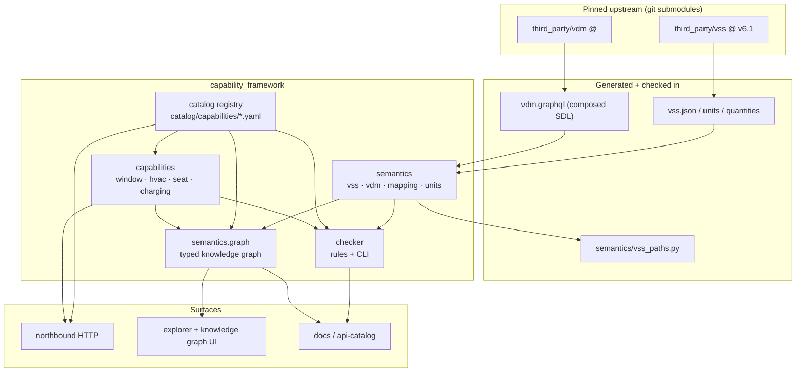

# COVESA Capability Framework — Standards Integration & Catalog Plan

> **Status:** Phases 0–3, 5, 6 delivered; Phase 4 (more capabilities) and Phase 7 (release) open
> **Scope:** This repository (`capability_framework`) and its runnable window example.
> **Goals:** (1) a complete example capability catalog, (2) a capability rule checker, (3) first-class VSS + VDM integration pinned as submodules, (4) a capability/VSS/VDM knowledge graph.


---

## 0. Implementation status (2026-10-29)

Phases 0, 1, and 5 are complete; Phases 2, 3, and 6 are complete except for the
items listed as open below; Phase 4 (more capabilities) and Phase 7 (release)
are untouched.

**Standards (Phases 1–2)**

- VSS pinned at **v6.1** (`2817646d1808`), VDM at commit `36bc93936eab`.
- `third_party/standards.lock.json` records refs, commits, licenses, and SHA-256 of
  every artifact; `scripts/vendor_standards.sh` regenerates and fails on hash drift.
- Generated `vss.json` (1382 signals) is **byte-identical to the official v6.1
  release artifact**; `vdm.graphql` (315 types) is composed from the pinned SDL.
- `capability_framework.semantics`: `VssCatalog`, `VdmSchema`, catalog model,
  `units` quantization, `VssSnapshot`, and generated `vss_paths`.
- VSS is used **at runtime**: `/vehicle/vss` serves `Position` (quantized to
  `uint8`), `IsOpen`, and a derived `Switch` per zone.

**Rules (Phase 3)**

- `capability-check` with 20+ rules across `CAP-0xx`–`CAP-6xx`, text/JSON/JUnit
  output, `--strict`, `--only`, `--baseline`.
- Wired into pytest, pre-commit, and `.github/workflows/standards.yml`.
- Baseline exemptions require rule, capability, reason, owner, and expiry; an
  expired exemption reports `CAP-900` and stops suppressing.

**Graph (Phase 5)**

- `semantics/graph.py` builds a deterministic typed graph (57 nodes, 118 edges for
  one capability) from catalog + contract + VSS + VDM + requirements + tests.
- `/vehicle/graph/` (text-first), `/vehicle/graph/model.json`,
  `/vehicle/graph/node/<id>?depth=`, `/vehicle/graph/search`.
- `make graph` exports `docs/graph/model.json` and a Mermaid flowchart per
  capability; `--check` fails when stale.

**Verification:** 87 tests pass; `make check` is clean with 0 warnings.

Defects the checker caught and that were fixed rather than baselined:

1. An HTTP route had no `operationId: orchestrate` in the contract (CAP-022).
2. VDM's VSS projection **collapses instance dimensions**
   (`Vehicle.Cabin.Door.Window.Position`), so naive path equality is wrong.
   Comparison now normalizes dimension segments first (CAP-342).

Still open: additional capabilities (Phase 4), a vendored canvas graph view,
`x-vss-instance-map` annotations in the contract, a capability template, and the
release/docs polish in Phase 7.

---

## 1. Outcomes

| # | Objective | Workstream | Definition of done |
|---|---|---|---|
| 1 | Complete example capability API catalog | **Catalog** | ≥ 4 fully specified capabilities (window + 3 more), each with descriptor, OpenAPI contract, implementation, binding, docs, requirements, and tests |
| 2 | Capability rule checker | **Rules** | `capability-check --strict` runs in pytest, pre-commit, and CI; every catalog entry passes; rules are documented and versioned |
| 3 | VSS + VDM integration | **Standards** | VSS and VDM are pinned git submodules; generated artifacts are reproducible; every VSS path in the repo resolves; the window example uses the integration at runtime |
| 4 | VSS / VDM / Capability graph | **Graph** | A searchable, drill-down knowledge graph served by the app and exportable as JSON/SVG, with a text-first fallback |

### Non-goals (for this plan)

- Production vehicle networking (CAN, SOME/IP, DDS) or a full VISS server.
- Conformance certification against COVESA standards.
- Exhaustive coverage of every VSS domain. The catalog is representative, not complete.

---

## 2. Current state (baseline)

Verified in this checkout:

- Python package `capability_framework` (Flask app, Python ≥ 3.10, bootstrapped on 3.14).
- One capability: `window`, with northbound HTTP, a southbound simulator binding, a bond-graph motor model, and two interactive explorer pages.
- VSS is referenced only as **string metadata** in descriptors and OpenAPI (`vss_paths`, `x-vss-path`, `x-vss-mapping`). Nothing validates those paths.
- `docs/api-catalog.yaml` mirrors a single window entry; the explorer blueprint is window-specific.
- No submodules, no standards lock file, no rule checker, no cross-standard graph.
- Tests: `tests/test_window_example.py`, `tests/test_explorer.py`.

**Gap:** the repository *claims* VSS alignment but cannot prove it, and it has no VDM story at all.

---

## 3. Research findings (standards)

### 3.1 VSS — Vehicle Signal Specification

- Upstream: <https://github.com/COVESA/vehicle_signal_specification>
- Latest release at time of writing: **v6.1** (published 2026-09-17).
- License: **MPL-2.0** (confirmed from the repository `LICENSE`).
- Source is a tree of `.vspec` files; releases publish ready-made artifacts:
  `vss.json`, `vss.yaml`, `vss.jsonschema`, `vss.csv`, `vss.idl`, `vss.fidl`,
  `units.yaml`, `quantities.yaml`, `vss_compose.tar.gz`, `vss_graphql.tar.gz`, and more.
- Versioning: tags `vX.Y(.Z)`; the master branch carries a `-dev` label in
  `spec/Vehicle/Vehicle.vspec`. VSS and vss-tools use a PEP-inspired scheme; the
  VSS repo pins a compatible vss-tools as a submodule.
- vss-tools CLI: `vspec export <format>`, `vspec compose`, `vspec diff`.
  `vspec compose` produces a self-contained snapshot; `vspec diff` reports
  structured changes between two snapshots — ideal for standards upgrades.
- vss-tools compatibility matters: the vss-tools linked by the chosen VSS tag is
  the supported pairing (see the vss-tools README compatibility table).

**Verified signal shape (VSS v6.1)** — this matters for the capability mapping:

```text
Vehicle.Cabin.Door.Row1.DriverSide.Window.Position
  datatype: uint8
  type: actuator
  unit: percent
  min: 0, max: 100
  description: Item position. 0 = Start position 100 = End position.

Vehicle.Cabin.Door.Row1.DriverSide.Window.IsOpen    # boolean
Vehicle.Cabin.Door.Row1.DriverSide.Window.Switch    # actuator
```

The four window zones exist as `Row1|Row2 × DriverSide|PassengerSide`. Note the
type mismatch to resolve explicitly: the capability API exposes `position_pct`
as a float, while VSS 6.1 models `Position` as `uint8` percent. The integration
needs a documented quantization boundary, not an accidental cast.

### 3.2 VDM — Vehicle Data Model

- Upstream: <https://github.com/COVESA/vdm>
- VDM formalizes data of common interest across vehicle-related sub-domains
  (in-vehicle and adjacent: charging sessions, in-cabin activity, infrastructure).
- Modeled with **S2DM** (<https://github.com/COVESA/s2dm>) using **GraphQL SDL**;
  SDL is authoring syntax only — no GraphQL API is implied.
- `spec/` contains GraphQL files such as `Address.graphql`, `ChargingSession.graphql`,
  `ChargingStation.graphql`, `CountryCode.graphql`, `Person.graphql`, `Query.graphql`,
  plus `spec/vss/` with `domain/`, `instances/`, `other/`, `vspec_reference/` —
  i.e. VDM already carries an explicit VSS projection.
- The VDM site publishes a docs browser and a **GraphQL Voyager** visualizer.
- **Important constraints found:**
  - No GitHub releases at time of writing — VDM must be pinned by **commit SHA**.
  - No `LICENSE` file detected in the repository root via the GitHub API.
    Licensing must be clarified before vendoring; until then, treat the pin as a
    review gate and record it in `THIRD_PARTY_NOTICES.md`.
  - VDM is cross-domain and does **not** currently expose a rich `Vehicle` type;
    the capability↔VDM link must be modeled as an explicit anchor/projection
    (e.g. capabilities attach to VDM entities such as `ChargingSession`) rather
    than assumed.

### 3.3 What this means for the design

1. **Pin both, generate locally.** Submodules give source provenance; checked-in
   generated artifacts give reproducibility and fast tests.
2. **VSS is the signal vocabulary; VDM is the cross-domain semantic layer.**
   A capability maps to VSS signals for state and to VDM entities for
   cross-domain context. Neither replaces the capability's own command/response
   semantics.
3. **Validation is the product.** A path string that merely *looks* like VSS is a
   liability. The rule checker must resolve every mapping against the pinned
   snapshots.
4. **Upgrades need a diff, not hope.** `vspec compose` + `vspec diff` and a lock
   file turn standards bumps into reviewable changes.

---

## 4. Target architecture



### Proposed repository layout

```text
adr/                                  # architecture decision records
catalog/
  capabilities/
    window.yaml                       # canonical descriptor (new)
    hvac.yaml
    seat.yaml
    charging.yaml
third_party/
  vss/                                # git submodule, tag v6.1
  vdm/                                # git submodule, pinned commit
  standards.lock.json                 # refs, commits, licenses, artifact hashes
  generated/
    vss.json  vss.jsonschema
    units.json  quantities.json
    vdm.graphql
scripts/
  vendor_standards.sh                 # checkout pins + regenerate + verify
  gen_vss_paths.py                    # emit semantics/vss_paths.py
  bump_standards.sh                   # upgrade workflow + diff report
src/capability_framework/
  semantics/
    vss.py  vdm.py  mapping.py  units.py  graph.py
    vss_paths.py                      # generated, checked in
  checker/
    engine.py  rules.py  cli.py  reporters.py
docs/
  standards/vss-vdm-integration.md
  standards-compatibility.md
  capability-rules.md
  knowledge-graph.md
  adding-a-capability.md
```

### Core model decisions

| Decision | Choice | Rationale |
|---|---|---|
| Descriptor source of truth | `catalog/capabilities/*.yaml` | Reviewable, language-neutral; Python descriptors are generated/validated from it |
| Standards artifacts | Generated by pinned tools, **checked in** | Reproducible offline builds; CI verifies freshness |
| VSS runtime model | Indexed from `vss.json` | Fast lookup, no `.vspec` parsing at runtime |
| VDM runtime model | Parsed composed SDL via `graphql-core` | Aligns with S2DM authoring; entity/field validation |
| Percent quantization | Northbound keeps `float`; VSS write-out rounds to `uint8` | Preserves API behavior and VSS conformance; documented at the boundary |
| Graph storage | In-memory typed graph, exported JSON | No database dependency; deterministic snapshots |
| Graph client | Vendored Cytoscape.js, text-first fallback | Offline, no CDN, accessible |

### Graph schema (first cut)

**Nodes:** `Capability`, `Operation`, `SouthboundPort`, `Contract`, `Schema`, `VssBranch`, `VssSignal`, `VdmType`, `VdmField`, `Requirement`, `TestCase`.

**Edges:** `PROVIDES`, `REQUIRES`, `MAPS_TO`, `CHILD_OF`, `HAS_SCHEMA`, `REFERENCES`, `IN_DOMAIN`, `VERIFIED_BY`, `PUBLISHES`.

Stable IDs: `cap:window`, `op:window.moveWindow`, `vss:Vehicle.Cabin.Door.Row1.DriverSide.Window.Position`, `vdm:ChargingSession`, `req:REQ-WIN-001`.

---

## 5. Phases

### Phase 0 — Foundations and decisions (1–2 days)

- [x] Capture the baseline: `PYTHONPATH=src .venv/bin/python -m pytest tests -q` (47 tests at commit `10fee0c`).
- [ ] Write ADRs:
  - [x] `adr/0001-pin-vss-and-vdm-as-submodules.md`
  - [x] `adr/0002-catalog-yaml-is-source-of-truth.md`
  - [x] `adr/0003-generated-standards-artifacts-are-checked-in.md`
  - [x] `adr/0004-knowledge-graph-model-and-ui.md`
- [x] Add a task runner (`Makefile`): `bootstrap`, `vendor`, `paths`, `graph`, `check`, `test`, `standards`.
- [x] Add optional dependency group `standards` (`pyyaml`, `graphql-core`, `vss-tools`) alongside `dev`; the runtime stays Flask-only and imports VDM lazily.
- [x] Create the `third_party/`, `catalog/`, `adr/`, and `scripts/` directories.
- [x] Add console scripts in `pyproject.toml`: `capability-check`, `capability-vss-pathgen`, `capability-graph`.
- [x] Add `.github/workflows/standards.yml` (pins, generated-path freshness, strict checker, JUnit artifact, tests, artifact reproducibility).

**Exit:** repository has a documented task surface and green baseline.

---

### Phase 1 — Pin VSS and VDM (2–3 days)

- [x] Add VSS as a submodule:
  - [x] `git submodule add https://github.com/COVESA/vehicle_signal_specification third_party/vss`
  - [x] Check out tag `v6.1`; record the resolved commit (`2817646d1808`).
- [x] Add VDM as a submodule:
  - [x] `git submodule add https://github.com/COVESA/vdm third_party/vdm`
  - [x] Check out a reviewed commit SHA (`36bc93936eab`; no releases exist yet).
- [x] Create `third_party/standards.lock.json` with, per standard: URL, ref, commit SHA, commit date, license, resolved vss-tools version, and SHA-256 of every generated artifact.
- [x] Write `scripts/vendor_standards.sh`:
  - [x] `git submodule update --init --recursive`
  - [x] Verify submodule HEAD equals the lock file (fail otherwise)
  - [x] Run the pinned vss-tools (`vspec export json`) to emit `vss.json` (byte-identical to the official v6.1 artifact)
  - [x] Compose VDM SDL into `vdm.graphql` (`scripts/gen_vdm_sdl.py`); S2DM tooling still to be pinned
  - [x] Verify artifact hashes and write them back to the lock file only in `--update` mode
- [x] Decide and document where vss-tools comes from: pinned PyPI `vss-tools==6.1.0` in `requirements-standards.txt`, matching the VSS tag.
- [x] Add `THIRD_PARTY_NOTICES.md`; record VSS's MPL-2.0 and the **open VDM licensing question**.
- [x] Update `bootstrap.sh` / README so a fresh clone initializes submodules.
- [x] Add `tests/test_standards_pins.py`: submodule commits match the lock file; artifact hashes match; `vss.json` parses.

**Exit:** `make vendor` reproduces byte-identical artifacts; pins are enforced by tests.

---

### Phase 2 — Semantic core and window retrofit (1 week)

**VSS layer**

- [x] `semantics/vss.py`
  - [x] `Signal` dataclass: path, datatype, type, unit, min, max, allowed values, description, children.
  - [x] Index loader for `vss.json` (`require`, `get`, `children`, `search`, `subtree`, `expand`).
  - [x] Instance handling for `Row1|Row2 × DriverSide|PassengerSide` (instances come from the catalog, not code).
- [x] `semantics/units.py`
  - [x] Unit compatibility (raises `UnitMismatch`; percent verified against the pin).
  - [x] Quantization policy: float → `uint8` percent, half-up rounding, range from the standard, `OutOfRange` instead of silent clamping.
- [x] `scripts/gen_vss_paths.py`
  - [x] Emit `semantics/vss_paths.py` constants for signals the catalog uses.
  - [x] Fail generation if a requested path is absent (`--check` mode for CI).

**VDM layer**

- [x] `semantics/vdm.py`
  - [x] Parse composed SDL with `graphql-core`; expose types, fields, and `@vspec`/`@range` annotations.
  - [x] `get`, `field`, `enum_values`, `search`, `normalize_vss_path`, `lookup_vss_path`.
- [x] `semantics/mapping.py`
  - [x] `CapabilitySpec` + `SignalRef`: capability → VSS signals with `state`/`command` roles and VDM refs.
  - [x] Zone/instance map: `DRIVER_FRONT` → `Vehicle.Cabin.Door.Row1.DriverSide.Window`.
  - [x] Optional VDM anchors (capability → VDM entity/field), validated against the composed schema.

**Window retrofit (start using standards immediately)**

- [x] Replace literal VSS paths in `WindowManager` with generated constants (`semantics/vss_paths.py`).
- [ ] Add `x-vss-instance-map` to the contract and validate it in the checker.
- [ ] Maintain a `VssSnapshot` reduced from capability events:
  - [x] Publish `Position` (quantized), `IsOpen`, and `Switch` per zone (`capabilities/window/vss.py`).
  - [x] Expose `GET /vehicle/vss` (flat signal map) and `GET /vehicle/vss/<path>`.
- [x] Preserve the northbound float API; document the VSS `uint8` boundary in the README and `docs/standards-compatibility.md`.
- [ ] Add tests:
  - [x] all window VSS paths resolve in pinned VSS;
  - [x] datatype/unit/min/max match the standard the contract cites;
  - [x] quantization is deterministic and range-safe;
  - [x] VSS snapshot updates after a move.

**Exit:** the window example is genuinely VSS-backed; no unvalidated VSS strings remain.

---

### Phase 3 — Capability rule checker (1 week)

- [x] `checker/engine.py`: rule registry, finding model (`rule_id`, severity, location, message, hint), deterministic ordering.
- [x] Reporters: text, JSON, and JUnit XML (`report(..., fmt=...)`).
- [x] `capability-check` CLI: `--catalog`, `--contracts`, `--standards`, `--tests`, `--baseline`, `--only`, `--strict`, `--format {text,json,junit}`.
- [x] Rule families and IDs (20+ rules across `CAP-0xx`–`CAP-6xx`):

| Family | Examples |
|---|---|
| Catalog `CAP-0xx` | unique name/id, SemVer, domain taxonomy, ASIL tier, display name, docs link, state topic |
| Contract `CAP-1xx` | OpenAPI 3.1 parses, `info.version` matches descriptor, operationIds cover northbound ops both directions, request/response schemas exist, frozen schemas, documented error responses, no self-asserted `source` |
| VSS `CAP-2xx` | every path resolves, datatype compatible, unit compatible, range inside VSS min/max, full instance coverage, no deprecated signals, no duplicate/ambiguous mapping |
| VDM `CAP-3xx` | referenced entity/field exists, relation direction and cardinality valid, anchor present when claimed |
| Boundary `CAP-4xx` | no hardware identifiers (CAN IDs, ECU/supplier names) in northbound schemas/descriptions; southbound dependencies match declared ports; handshake methods present |
| Safety `CAP-5xx` | requirement IDs present, each requirement maps to a test, safety-relevant operations declare preconditions |
| Tests `CAP-6xx` | every northbound operation has at least one test; every capability has a catalog entry and docs |

- [ ] Integrate:
  - [x] pytest test (`tests/test_capability_rules.py`) over every catalog entry;
  - [x] pre-commit hooks (rules, generated paths, pins);
  - [x] CI `--strict`.
- [x] Fix all current window violations; `checker/baseline.yaml` supports owner/reason/expiry exemptions with `CAP-900` on expiry (currently empty).
- [ ] Add a capability template (`templates/capability/`) that passes `--strict` out of the box.
- [x] Document rule meanings in `docs/capability-rules.md`.

**Exit:** adding a capability without a contract, valid VSS paths, and tests fails CI.

---

### Phase 4 — Complete example catalog (2 weeks)

- [ ] Introduce `CapabilityRegistry`; load descriptors from `catalog/capabilities/*.yaml`.
- [ ] Migrate `window` to the YAML descriptor; generate `docs/api-catalog.yaml` and the runtime catalog from the registry.
- [ ] Add three capabilities spanning domains and VSS branches:
  - [ ] **HVAC / climate** — `Vehicle.Cabin.HVAC.*` (setpoint, fan, mode), with preconditions.
  - [ ] **Seat** — `Vehicle.Cabin.Seat.*` (position, heating), with arbitration.
  - [ ] **Charging** — `Vehicle.Powertrain.TractionBattery.Charging.*`, linked to VDM `ChargingSession` / `ChargingStation` as the first cross-domain VDM demonstration.
  - [ ] Optional fourth: **locking/entry** — `Vehicle.Cabin.Door.*.IsLocked` plus body signals.
- [ ] For each capability deliver:
  - [ ] descriptor YAML; OpenAPI contract; Python types + manager; simulator binding; simplified plant model; requirements doc; docs page; tests; VSS + VDM mapping.
- [ ] Generalize the northbound adapter (or add per-capability blueprints) while keeping the existing window URLs stable.
- [ ] Generalize the explorer: catalog, boundary diagram, and playground become descriptor-driven; remove window-specific branches.
- [ ] Run `capability-check --strict` over all capabilities.
- [ ] Update README and `docs/system-overview.html` for the multi-capability catalog.

**Exit:** ≥ 4 capabilities, all green, one demonstrating VDM linkage.

---

### Phase 5 — Knowledge graph (2 weeks)

- [x] `semantics/graph.py`
  - [x] Build the typed graph from: catalog entries, contract schemas, VSS index, VDM schema, requirements, and test names.
  - [x] Deterministic ordering and stable IDs.
  - [x] Subgraph extraction by root and depth; layer/type/domain queries via `by_layer`, `by_type`, `count_by`.
- [x] Endpoints:
  - [ ] `GET /vehicle/graph/model.json` — full graph.
  - [ ] `GET /vehicle/graph/subgraph?root=<id>&depth=<n>`
  - [ ] `GET /vehicle/graph/search?q=<text>`
  - [ ] `GET /vehicle/graph/export.svg`
- [ ] UI at `/vehicle/knowledge-graph/`:
  - [x] Text-first table/tree (capability → operations → schemas → VSS/VDM) that works without JS.
  - [ ] Interactive canvas using a **vendored** graph library (Cytoscape.js preferred), no CDN.
  - [ ] Layer toggles: capabilities, contracts, VSS, VDM.
  - [x] Search, focus, and a details panel with neighbour navigation.
  - [ ] Deep links from catalog, boundary diagram, and API explorer into the graph.
  - [ ] Keyboard navigation and accessible labels.
- [x] Generate a static graph snapshot for docs (`docs/graph/model.json` + `<capability>.mmd`) via `make graph`.
- [x] Tests: graph determinism, every edge endpoint exists, subgraph bounds, endpoints.
- [ ] Performance budget: full catalog graph renders in < 2 s locally; large VSS subtrees are lazy-loaded on expand.

**Exit:** a user can start at `window`, see its operations, contracts, VSS signals, and related VDM entities, and navigate in both directions.

---

### Phase 6 — Versioning and upgrade workflow (3–4 days)

- [x] `docs/standards-compatibility.md`: framework version ↔ VSS tag ↔ VDM commit ↔ vss-tools version ↔ generated artifact hashes.
- [x] `scripts/bump_standards.sh <vss-ref> <vdm-ref>`:
  - [ ] Update submodules and lock file.
  - [ ] Regenerate artifacts.
  - [ ] Produce a `vspec compose` snapshot before/after and a `vspec diff` report.
  - [ ] Run `capability-check --strict` and the full test suite.
  - [ ] Emit an upgrade report under `docs/upgrades/<date>-<vss>.md`.
- [x] CI job: submodule HEAD == lock file; `make vendor && git diff --exit-code` proves artifacts are fresh.
- [ ] Define SemVer policy:
  - [x] framework release: minor for new capabilities, major for northbound breaking changes;
  - [ ] capability API version: major for schema/behavior breaks, minor for additive fields;
  - [ ] standards pins may move in a minor release unless a mapping break is required.
- [ ] Add `vspec diff` and OpenAPI diff to the release checklist.

**Exit:** a standards upgrade is a one-command, reviewable change with a compatibility report.

---

### Phase 7 — Docs, developer experience, release (3–4 days)

- [ ] Documentation:
  - [ ] `docs/standards/vss-vdm-integration.md` — model, pins, quantization, mapping rules.
  - [ ] `docs/capability-rules.md` — rule catalog, severities, exemptions.
  - [ ] `docs/knowledge-graph.md` — schema, endpoints, UI, export.
  - [ ] `docs/adding-a-capability.md` — template → descriptor → contract → implementation → tests → graph.
  - [ ] `docs/standards-compatibility.md` — version matrix.
- [ ] Update README: replace "VSS-aligned" claims with "validated against pinned VSS v6.1"; add VDM and graph sections; include screenshots.
- [ ] CI hardening: Python 3.10–3.14 matrix, checker strict, artifact freshness, graph determinism, submodule pins, docs link check.
- [ ] Package data: ship generated `vss.json`/`vdm.graphql`/`vss_paths.py` in the wheel (or document the dev-only path clearly).
- [ ] Release `0.2.0` with changelog, upgraded catalog, and graph.

**Exit:** a new contributor can add a capability and get it validated end-to-end by following one document.

---

## 6. Sequencing

| Phase | Depends on | Estimate |
|---|---|---|
| 0 Foundations | — | 1–2 days |
| 1 Standards pins | 0 | 2–3 days |
| 2 Semantic core + window | 1 | 1 week |
| 3 Rule checker | 2 | 1 week |
| 4 Catalog expansion | 2, 3 | 2 weeks |
| 5 Knowledge graph | 2, 3, 4 | 2 weeks |
| 6 Upgrade workflow | 1, 3 | 3–4 days |
| 7 Docs + CI + release | all | 3–4 days |

Phases 3 and 5 can overlap with Phase 4 once the semantic core is stable. Phase 6 can start after Phase 3 because the diff workflow only needs the checker and pins.

---

## 7. Acceptance criteria

- [ ] `git submodule status` shows VSS at `v6.1` and VDM at the reviewed commit; both match `third_party/standards.lock.json`.
- [ ] `make vendor` regenerates artifacts with matching SHA-256 hashes on a clean checkout.
- [ ] Every `vss_paths` / `x-vss-path` / `x-vss-mapping` value resolves in the pinned VSS, with compatible datatype, unit, and range.
- [ ] The window capability publishes VSS-shaped state at runtime; the northbound float ↔ VSS `uint8` boundary is documented and tested.
- [ ] At least one capability links to a VDM entity and the link is validated.
- [ ] `capability-check --strict` passes for every catalog entry in CI.
- [ ] The catalog contains ≥ 4 complete capabilities, each with descriptor, contract, implementation, binding, docs, requirements, and tests.
- [ ] The knowledge graph renders from live catalog + VSS + VDM data, supports search and drill-down, and has a no-JS fallback.
- [ ] `docs/standards-compatibility.md` and the upgrade runbook are current.
- [ ] README claims match what the repository actually enforces.

---

## 8. Risks and mitigations

| Risk | Mitigation |
|---|---|
| VDM has no releases and no detected license file | Pin by commit, isolate behind `semantics/vdm.py`, clarify licensing with COVESA before distribution, record in `THIRD_PARTY_NOTICES.md` |
| VSS path/type drift between versions | Lock file + `vspec diff` + checker; upgrades are explicit PRs with a report |
| Float percent vs VSS `uint8` percent | Documented quantization at the boundary; round-trip tests |
| VDM is cross-domain with no rich Vehicle type | Use explicit anchors (e.g. `ChargingSession`) instead of inventing a Vehicle entity; revisit when VDM adds one |
| Graph becomes a hairball | Layer toggles, subgraph queries, depth limits, text-first navigation, lazy expansion |
| Catalog scope creep | Fixed first set of 4 capabilities; template and checker enforce completeness before adding more |
| Generated artifacts drift from source | CI freshness check and hash verification |
| Python dependency weight (`graphql-core`, validators) | Put semantics/checker behind optional extras; keep the runtime window example Flask-only |

---

## 9. Open questions

- [ ] Confirm the first capabilities: HVAC, seat, charging (VSS + VDM), optional locking.
- [ ] Confirm whether generated standards artifacts should be checked in (recommended) or built in CI only.
- [ ] Confirm the VDM license position before any redistribution.
- [ ] Choose the graph client: Cytoscape.js (recommended) vs D3 vs server-rendered SVG only.
- [ ] Decide whether capability descriptors live in `catalog/` YAML (recommended) or remain Python-first with YAML generated.
- [ ] Decide whether to expose a read-only VSS service endpoint (VISS-style) or keep `/vehicle/vss` as a simple snapshot API.

